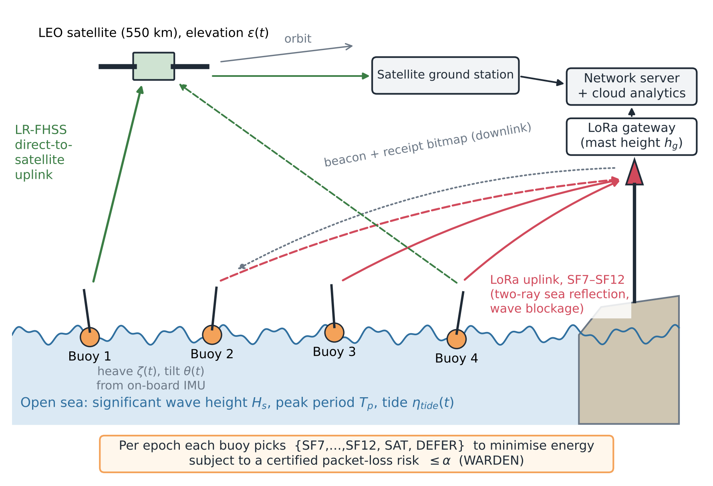
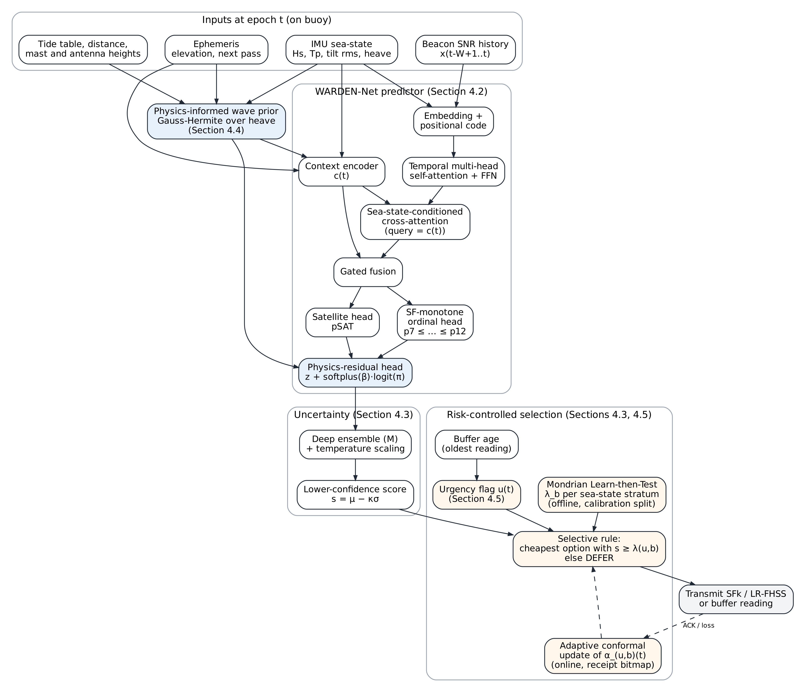

# WARDEN — Wave Aware Risk Controlled Link Selection for Hybrid LoRa and LEO Satellite Ocean Monitoring IoT

Official implementation of the article

> G. Arul Dalton (Member, IEEE) and S. V. J. Mani, *"Wave Aware Risk Controlled Link Selection for Hybrid LoRa and LEO Satellite Ocean Monitoring IoT"*, manuscript submitted to the IEEE Internet of Things Journal, 2026.

Every reporting epoch, an ocean buoy must choose between **LoRa SF7–SF12** towards a shore or platform gateway, an **LR-FHSS direct-to-satellite** frame during a LEO pass, or **buffering** the reading. WARDEN makes this choice with a **certified bound on the attempt-failure probability**, separately for calm, moderate and rough seas, while minimising energy.

<p align="center"></p>

## What is inside

| Component | Idea | Code |
|---|---|---|
| Physics-informed wave prior (WARDEN-PI) | Two-ray sea channel integrated over the IMU-measured heave (Gauss–Hermite), plus tide, blockage and LEO geometry | `warden/physics_prior.py` |
| WARDEN-Net | Temporal self-attention, sea-state-conditioned cross attention, gated fusion, SF-monotone head, physics-residual head | `warden/models.py` |
| Uncertainty | 3-member deep ensemble, per-action temperature scaling, lower-confidence score μ − κσ | scripts, `warden/calib.py` |
| Mondrian Learn-then-Test | Finite-sample guarantee P[R_b ≤ α] ≥ 1 − δ per sea-state stratum, no monotonicity needed | `calib.calibrate`, `calib.ltt_lambda` |
| Adaptive conformal updates | Long-run risk = α under storms and site changes, driven by the gateway receipt bitmap | `calib.online_aci` |
| Urgency-aware cells (WARDEN-U) | Separate certified cells for readings about to expire | `calib.online_two_tier` |
| Sandbox test bed | Tides, heave/tilt, blockage, ducting, shadowing, Rician fading, LEO passes, LR-FHSS, energy model | `warden/channel.py`, `warden/dataset.py` |
| NumPy autodiff | Small reverse-mode engine, so no deep-learning framework is required | `warden/autograd.py` |

The full equation-to-code map, hyper-parameters and splits are in **[docs/IMPLEMENTATION.md](docs/IMPLEMENTATION.md)**.

<p align="center"></p>

## Repository layout

```
warden/                 core library
  channel.py            sea state, buoy motion, LoRa over sea, LEO/LR-FHSS link, energy
  dataset.py            20-buoy x 60-day deployment generator, windows, context, labels, strata
  physics_prior.py      closed-form wave-averaged success prior (+ misspecified variant)
  autograd.py           NumPy reverse-mode autodiff, Adam
  models.py             WARDEN-Net, Transformer and GRU baselines, training loop
  calib.py              calibration, metrics, selective rule, Mondrian LTT, online ACI, WARDEN-U, ADR, oracle
scripts/
  run_experiments.py    base WARDEN: predictors, policies, OOD, robustness, ablations, trade-offs, n_cal
  run_v2.py             WARDEN-PI, WARDEN-U, prior misspecification
  run_lowdata.py        commissioning with 2 / 4 / 8 days of labels
  make_figures.py       Figs. 3-5, 8-11 and results/tables.md
  make_figures_v2.py    Figs. 6-7 and results/tables_lowdata.md
  show_v2.py            aggregated v2 tables (mean +/- std over seeds)
  fig_system.py         system-model Figs. 1-2 (Graphviz)
  fig_ieee.py           column-width figures for the IEEE IoT Journal version
examples/quickstart.py  5-minute end-to-end demo
tests/                  gradient checks, risk-control checks, simulator checks
docs/IMPLEMENTATION.md  implementation details
results/                per-seed JSON outputs, logs and aggregated tables of the paper
figures/                all figures (PNG + PDF)
paper/                  Springer version: Markdown sources, build.sh -> PDF (XeLaTeX), Word (make_springer_docx.py)
paper_ieee/             IEEE Internet of Things Journal version (8 pages, IEEEtran):
  main.tex              LaTeX source (uses IEEEtran.cls when installed, e.g. on Overleaf)
  refs_src.tex          references; order_refs.py numbers them by first citation -> refs.tex
  tex2md.py, make_ieee_docx.py   IEEE two-column Word manuscript with editable equations
  figs/                 figures used by the IEEE version
run_all.sh              reproduces every number in the paper
```

## Installation

Requires Python ≥ 3.10 and CPU only.

```bash
git clone https://github.com/iitrky/warden.git
cd warden
python -m venv .venv && source .venv/bin/activate      # Windows: .venv\Scripts\activate
pip install -r requirements.txt
python -m pytest -q tests                              # 10 tests, about 3 s
```

The code was tested with Python 3.13, NumPy 2.5, SciPy 1.18, scikit-learn 1.9 and Matplotlib 3.11. Graphviz (`dot`) is needed only for Fig. 2, and pandoc with XeLaTeX only to rebuild the manuscript.

## Quick start

```bash
python examples/quickstart.py
```

This simulates 8 buoys for 30 days, trains one WARDEN-PI network, certifies it with Mondrian LTT and evaluates the urgency-aware online policy against the ADR rule. Example output:

```
ADR 10 dB                risk 0.142  RDR 0.858  energy/reading 208.5 mJ
WARDEN-PI offline LTT    risk 0.061  RDR 0.837  energy/reading 48.2 mJ
WARDEN-PI-U online       risk 0.049  RDR 0.864  energy/reading 44.4 mJ
```

In this small demo the calibration block is short and the weather drifts between calibration and test, so the offline certificate can be exceeded. The online update corrects this, which is exactly the behaviour studied in the distribution-shift experiments of the paper (Sec. VI-C of the IEEE version).

## Using the library

```python
from warden import dataset as ds, calib as cb
from warden.models import WardenNet, fit, predict_logits

dep  = ds.simulate_deployment(seed=1)                 # 20 buoys, 60 days, 10-min epochs
tr   = ds.build_arrays(dep, 0, 36)                    # dict: seq, ctx, prior, y, vis, strat, buoy, t
net  = WardenNet(d_seq=7, d_ctx=10, win=ds.WINDOW, prior=True)
...
lam, L_cal = cb.calibrate(scores_cal, cal, alpha=0.05, delta=0.10)      # Mondrian LTT
res = cb.online_two_tier(scores_test, test, L_cal, cal["strat"], alpha=0.05, alpha_u=0.05)
print(res["risk"], res["rdr"], res["energy_per_reading_mJ"])
```

## Reproducing the paper

```bash
./run_all.sh            # about 2.5 h on 2 cores; runs tests, 3 seeds x 3 studies, then all figures and tables
```

Or run the steps one at a time:

```bash
for s in 1 2 3; do
  python scripts/run_experiments.py --seed $s
  python scripts/run_v2.py --seed $s
  python scripts/run_lowdata.py --seed $s
done
python scripts/make_figures.py && python scripts/make_figures_v2.py && python scripts/fig_system.py && python scripts/fig_ieee.py
```

Run the seeds sequentially, because two parallel runs need about 6 GB of RAM. Add `--quick` to `run_experiments.py` or `run_v2.py` for a 4-minute smoke test.

## Rebuilding the manuscripts

```bash
cd paper_ieee && pdflatex main.tex && pdflatex main.tex          # IEEE IoT-J PDF (8 pages)
python3 tex2md.py && python3 make_ieee_docx.py ieee.md WARDEN_IEEE_IoTJ.docx   # IEEE Word version
cd ../paper && ./build.sh                                          # Springer PDF + Word version
```

## Main results (mean of three seeds, α = 0.05, δ = 0.1)

| Scenario | Policy | Failure risk | Reading delivery | Energy / reading |
|---|---|---|---|---|
| In distribution | ADR, 10 dB margin | 0.158 | 0.842 | 162.5 mJ |
| In distribution | WARDEN (base, online) | 0.050 | 0.808 | 32.6 mJ |
| In distribution | WARDEN-PI | 0.050 | 0.834 | 35.5 mJ |
| In distribution | **WARDEN-PI-U** | **0.049** | **0.862** | **35.3 mJ** |
| Severe storms (OOD-A) | ADR, 10 dB margin | 0.195 | 0.805 | 185.9 mJ |
| Severe storms (OOD-A) | **WARDEN-PI-U** | **0.049** | **0.845** | **40.9 mJ** |
| Site shift (OOD-B) | ADR, 10 dB margin | 0.097 | 0.903 | 111.2 mJ |
| Site shift (OOD-B) | **WARDEN-PI-U** | **0.049** | **0.900** | **26.5 mJ** |

The certificate also holds with a deliberately misspecified physics prior (risk 0.045–0.050), where the cost is energy rather than reliability. With only 2 days of labelled data, WARDEN-PI-U already delivers 0.848 of readings. Per-seed numbers are in `results/`.

**Scope:** all results come from the included physics-guided simulation test bed. They are not sea-trial measurements.

## Citation

```bibtex
@article{aruldalton2026warden,
  author  = {Arul Dalton, G. and Mani, S. V. J.},
  title   = {Wave Aware Risk Controlled Link Selection for Hybrid {LoRa} and {LEO} Satellite Ocean Monitoring {IoT}},
  year    = {2026},
  note    = {Manuscript under review; code: https://github.com/iitrky/warden}
}
```

A `CITATION.cff` file is included, so GitHub shows a "Cite this repository" button.

## Contact

G. Arul Dalton (corresponding author): aruldalton@saveetha.ac.in. Department of Computer Science and Engineering, Saveetha Engineering College, Chennai, India. ORCID 0000-0002-5981-7176.

## License

MIT, see [LICENSE](LICENSE).
