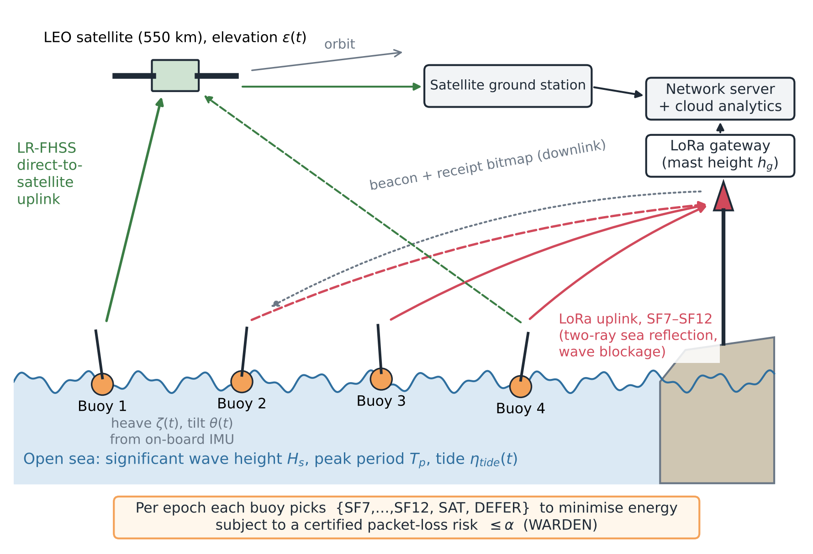

# 3 Problem formulation and motivation for selective prediction (system model)

## 3.1 Network model

Figure 1 shows the network view. A set $\mathcal{B}=\{1,\dots,N\}$ of moored buoys at distances $d_n$ from a LoRa gateway mounted on a mast of nominal height $\bar h_g$ (shore or offshore platform) produce one sensor reading per reporting epoch of length $\Delta$ (10 min). In epoch $t$ buoy $n$ chooses an action $a_{n,t}\in\mathcal{A}=\{\mathrm{SF7},\dots,\mathrm{SF12},\mathrm{SAT},\varnothing\}$, where SAT denotes an LR-FHSS direct-to-satellite frame and $\varnothing$ means that the reading is buffered. The gateway broadcasts a short beacon at the start of every epoch; the beacon carries a receipt bitmap of the previous epoch, so each buoy learns whether its last attempt succeeded and measures the downlink SNR as a proxy for the reciprocal uplink channel. Uplinks are unconfirmed: a failed attempt loses every reading it carried.

{width=95%}

## 3.2 Sea state and buoy motion

The sea is described by the significant wave height $H_s(t)$ and the peak period $T_p(t)$. For a buoy that follows the surface, the vertical displacement (heave) is modelled as a zero-mean Gaussian process whose standard deviation follows from the definition of $H_s$:

$$\zeta_n(t)\sim\mathcal{N}\!\left(0,\;(H_s(t)/4)^2\right). \tag{1}$$

Hull tilt scales with the wave slope. With peak wavelength $L_p=gT_p^2/(2\pi)$ and a hull response factor $\kappa_b$,

$$\theta_{\mathrm{rms}}(t)=\kappa_b\,\frac{\pi H_s(t)}{\sqrt{2}\,L_p(t)},\qquad \theta_n(t)=|\theta_{\mathrm{rms}}(t)\,u|,\;u\sim\mathcal{N}(0,1). \tag{2}$$

The buoy IMU provides noisy estimates $\hat H_s,\hat T_p,\hat\theta_{\mathrm{rms}}$ over the beacon window; these are the only sea-state quantities available to the decision engine.

## 3.3 Terrestrial LoRa link over the sea

The instantaneous antenna heights are $h_b(t)=h_0+\zeta_n(t)$ for the buoy and $h_g(t)=\bar h_g+A_{\mathrm{tide}}\sin(2\pi t/T_{M2}+\phi)$ for the gateway, where the semidiurnal tide ($T_{M2}=12.42$ h) changes the mast height above the water. The direct and sea-reflected rays differ in phase by

$$\Delta\varphi(t)=\frac{4\pi h_g(t)\,h_b(t)}{\lambda d_n}. \tag{3}$$

At the small grazing angle $\psi\approx(h_g+h_b)/d_n$ the reflection coefficient $\Gamma$ is close to $-1$; surface roughness reduces the coherent reflection by the Ament factor

$$\rho(t)=\exp\!\left[-8\left(\frac{\pi\sigma_h\sin\psi}{\lambda}\right)^2\right],\qquad \sigma_h=H_s/4. \tag{4}$$

Beyond the radio horizon $d_h=\sqrt{2kR_E}\,(\sqrt{h_g}+\sqrt{h_b})$ a diffraction penalty with slope $\beta$ is added, giving the path loss

$$PL(t)=20\log_{10}\frac{4\pi d_n}{\lambda}-20\log_{10}\left|1+\Gamma\rho(t)e^{-j\Delta\varphi(t)}\right|+\beta\,(d_n-d_h)^{+}. \tag{5}$$

The uplink SNR combines transmit power $P_t$, the tilted monopole gain $G_b(\theta)=2.15+10\log_{10}\cos^2\theta$ dBi, the gateway gain $G_g$, a log-normal AR(1) shadowing term $S(t)$, a ducting gain $D(t)\ge 0$, a wave-blockage loss $B(t)$ that appears when crests rise above the antenna, Rician fading $F(t)$ whose K-factor falls with $H_s$, and the noise floor $N_0=-174+10\log_{10}W+NF$:

$$\mathrm{SNR}_L(t)=P_t+G_b(\theta_n)+G_g-PL(t)+S(t)+D(t)-B(t)+F(t)-N_0. \tag{6}$$

A frame sent with spreading factor $k$ succeeds when the SNR exceeds the demodulation threshold $\gamma_k$ and no collision occurs. With offered background load $G$ and time on air $T_k$,

$$Y_k(t)=\mathbb{1}\{\mathrm{SNR}_L(t)\ge\gamma_k\}\cdot\mathbb{1}\{\text{no collision}\},\qquad \Pr[\text{collision}]=1-e^{-2GT_k}. \tag{7}$$

Because $\gamma_7>\gamma_8>\dots>\gamma_{12}$, the SNR part of (7) is nested: whenever SF$k$ succeeds, every larger SF would also have cleared the threshold. This ordering is exploited by the output head in Section 4.

## 3.4 LEO satellite link

A LEO satellite at altitude $h_s$ is visible during passes with elevation $\varepsilon(t)$, known on board from ephemeris. The slant range is

$$r(\varepsilon)=\sqrt{(R_E+h_s)^2-R_E^2\cos^2\varepsilon}-R_E\sin\varepsilon, \tag{8}$$

and the LR-FHSS link margin, with a hemispherical buoy antenna gain $G_q(\cdot)$ evaluated at the tilt-corrected elevation, is

$$M_S(t)=P_s+G_q(\varepsilon-\theta_n)+G_{\mathrm{sat}}-20\log_{10}\frac{4\pi r(\varepsilon)}{\lambda}-L_a-P_{\mathrm{sens}}+F_S(t). \tag{9}$$

The satellite frame succeeds when $M_S\ge 0$, it is not lost to the Doppler rate at low elevation (probability $p_D(\varepsilon)$, after [17]) and it does not collide with other DtS users.

## 3.5 Energy model

The energy of one attempt is the radio's electrical power multiplied by the time on air,

$$E_a=P_{\mathrm{elec}}(a)\,T_a,\qquad E_\varnothing=0, \tag{10}$$

with the standard LoRa time on air for payload $L$ bytes, bandwidth $W$ and coding rate $CR$:

$$T_k=\left(n_p+4.25\right)\frac{2^k}{W}+\left[8+\max\!\left(\left\lceil\frac{8L-4k+44}{4(k-2\,DE)}\right\rceil(CR+4),0\right)\right]\frac{2^k}{W}. \tag{11}$$

For a 20-byte payload this gives 8.5 mJ at SF7, 197.8 mJ at SF12 and 780 mJ for a 2-s LR-FHSS frame at 22 dBm, a ratio of almost 1:100 between the cheapest and the most expensive action.

## 3.6 Problem statements

The analysis above leads to five concrete problem statements.

* **P1 (wave-coupled non-stationarity).** Through (1)–(6) the link budget depends on $H_s$, $T_p$, the tide and ducting, so a fixed SNR margin is too generous in calm water and too optimistic in rough water.
* **P2 (heterogeneous action costs).** Actions differ by two orders of magnitude in energy (10), and the satellite action exists only during passes (8)–(9).
* **P3 (unquantified reliability).** Existing learned link predictors output point estimates or uncalibrated scores; a buoy cannot tell how often its decisions will fail.
* **P4 (distribution shift).** Storms, hardware changes and new sites shift the joint distribution of inputs and outcomes after deployment.
* **P5 (deadline pressure).** A reading that cannot be delivered within the buffer age limit is lost, so a policy that is safe on average may still discard data that are about to expire.

## 3.7 Research gap

The literature reviewed in Section 2 leaves five gaps. **G1:** learned LoRa link adaptation, including maritime deep reinforcement learning [25–27], optimises average reward and gives no bound on how often its decisions fail. **G2:** on-board motion data have been used to predict received power [28], but not to condition a reliability guarantee or to drive a physical channel prior for a hybrid LoRa and satellite choice. **G3:** conformal guarantees in wireless AI [29, 31] address prediction sets, not the risk of a sequential, cost-ordered choice whose loss is non-monotone. **G4:** guarantees that hold per sea state and recover after shift have not been studied for maritime links. **G5:** no scheme allocates reliability budgets according to data urgency, so certified schemes either waste energy on stale data or drop readings that are about to expire.

## 3.8 Motivation for selective prediction and formal problem

Deferring is the natural abstention option of a buoy: a reading kept in the buffer can ride on the next successful frame. Link selection is therefore a selective prediction problem in which abstention trades latency for reliability and energy. Let $x_{n,t}$ denote the inputs available before epoch $t$ (Section 4.1), $Y_{n,t}\in\{0,1\}^{7}$ the success indicators of the seven transmit actions, and $b(x)\in\{\text{calm},\text{moderate},\text{rough}\}$ the sea-state stratum given by $\hat H_s<1$ m, $1\le\hat H_s<2$ m and $\hat H_s\ge 2$ m. For a policy $\pi$ the attempt-failure loss and its risk are

$$\ell(\pi;x,Y)=\mathbb{1}\{\pi(x)\ne\varnothing\}\,\left(1-Y_{\pi(x)}\right),\qquad R_b(\pi)=\mathbb{E}\left[\ell(\pi;x,Y)\mid b(x)=b\right]. \tag{12}$$

WARDEN seeks the policy of least expected energy subject to a per-stratum risk budget that holds with high confidence over the randomness of the calibration data:

$$\min_{\pi}\;\mathbb{E}\left[E_{\pi(x)}\right]\quad\text{s.t.}\quad \Pr\left[R_b(\pi)\le\alpha\right]\ge 1-\delta,\;\;\forall b. \tag{13}$$

Problem (13) is solved within the threshold family

$$\pi_{\boldsymbol\lambda}(x)=\begin{cases}\min\{a\in\mathcal{A}_t\setminus\{\varnothing\}:s_a(x)\ge\lambda_{b(x)}\}, & \text{if the set is non-empty},\\ \varnothing, & \text{otherwise},\end{cases} \tag{14}$$

where actions are ordered by energy, $\mathcal{A}_t$ excludes SAT outside passes and $s_a(x)$ is the calibrated, uncertainty-penalised success score of Section 4.3. Raising $\lambda_b$ moves the choice towards more robust actions or towards deferral; it does not make the loss monotone, because a more robust action can still fail on a given draw. This is why Learn-then-Test [34], rather than conformal risk control for monotone losses [33], is used.

\needspace{16\baselineskip}

**Table 2** Main symbols

| Symbol | Meaning |
|------------------------------|----------------------------------------------------------------------|
| $N$, $n$, $t$, $\Delta$ | number of buoys, buoy index, epoch index, epoch length (10 min) |
| $H_s,\;T_p,\;L_p$ | significant wave height, peak period, peak wavelength |
| $\zeta,\;\theta,\;\kappa_b$ | heave, tilt, hull response factor |
| $\hat H_s,\hat T_p,\hat\theta_{\mathrm{rms}}$ | IMU estimates of the sea state |
| $h_b,\;h_g,\;A_{\mathrm{tide}}$ | buoy antenna height, gateway height above sea, tidal amplitude |
| $d_n,\;d_h,\;\lambda$ | buoy–gateway distance, radio horizon, wavelength |
| $\Gamma,\;\rho,\;\psi$ | sea reflection coefficient, roughness factor, grazing angle |
| $S,\;D,\;B,\;F$ | shadowing, ducting gain, wave blockage, small-scale fading (dB) |
| $\gamma_k,\;T_k$ | SNR threshold and time on air of SF$k$ |
| $\varepsilon,\;r(\varepsilon),\;M_S$ | satellite elevation, slant range, LR-FHSS link margin |
| $\mathcal{A}$, $a$, $\varnothing$ | action set, action, defer action |
| $E_a$ | energy of action $a$ |
| $Y\in\{0,1\}^7$ | per-action success indicators |
| $b(x)$ | sea-state stratum |
| $\mu_a,\;\sigma_a,\;s_a$ | ensemble mean, ensemble spread, penalised score |
| $\kappa$ | uncertainty penalty |
| $\alpha,\;\delta$ | target risk, confidence parameter |
| $\lambda_b$, $\Lambda$ | stratum threshold, threshold grid |
| $\gamma$ | adaptive-conformal step size |
| $W$, $d$, $H$ | history length, embedding width, attention heads |
| $\pi_k,\;\ell_k$ | physics-prior success probability of action $k$ and its logit |
| $Q,\;\xi_q,\;w_q$ | Gauss–Hermite order, nodes and weights |
| $\sigma_r,\;L_B,\;p_B$ | residual spread, blockage loss, blockage probability in the prior |
| $\beta_{\mathrm{SF}},\;\beta_{\mathrm{S}}$ | learnable weights of the physics-residual head |
| $u_t,\;g,\;A_{\max}$ | urgency flag, guard interval, buffer age limit |
| $\alpha_U,\;\rho_U$ | urgent-traffic risk target, share of urgent epochs |

