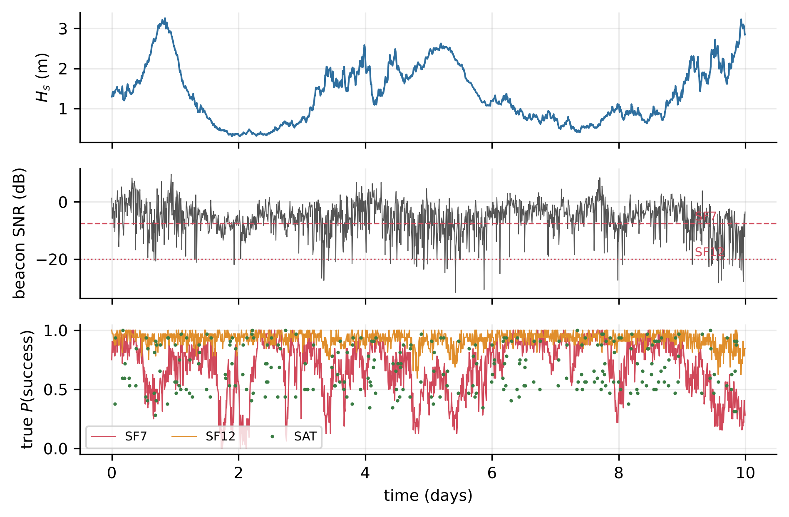
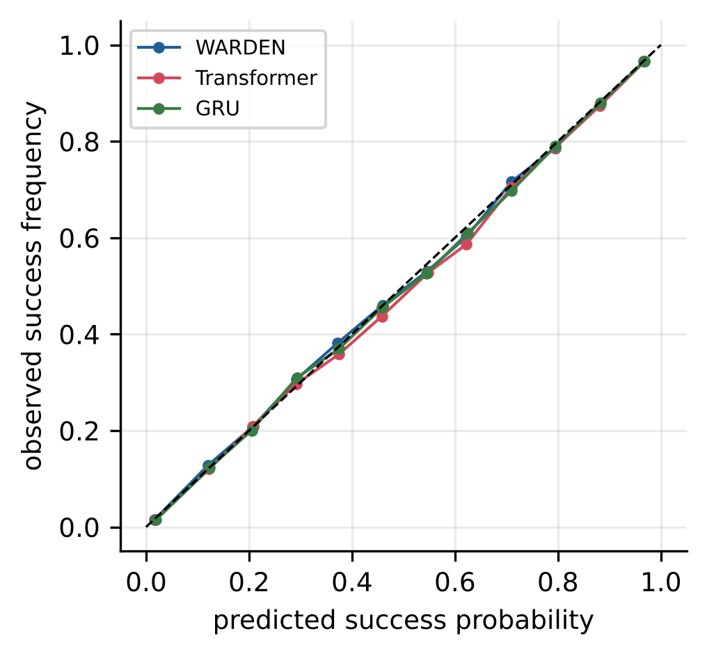
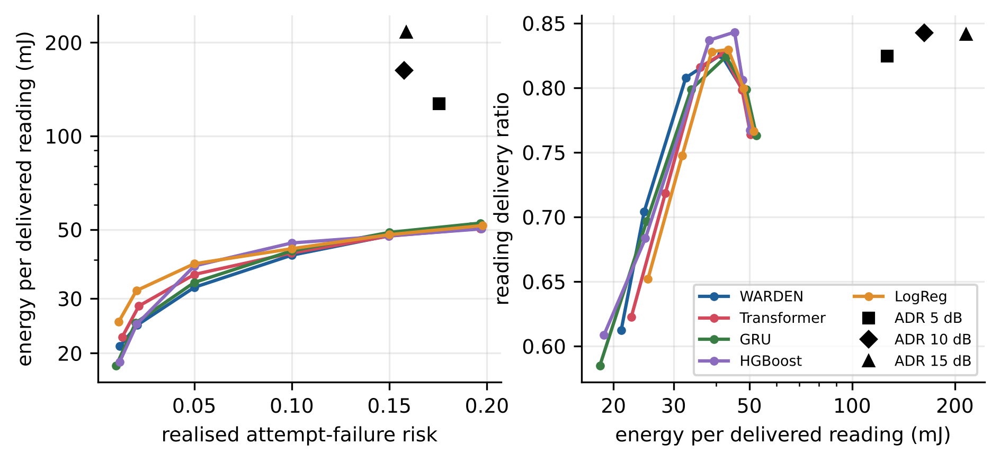
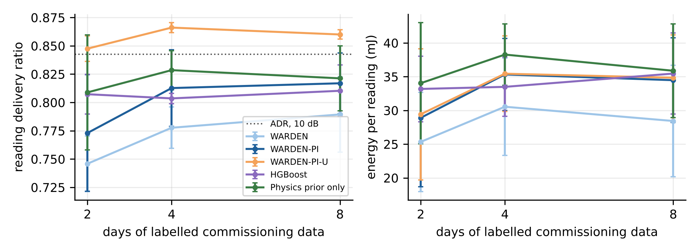
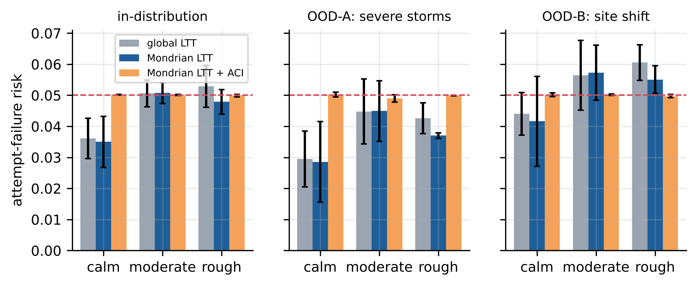
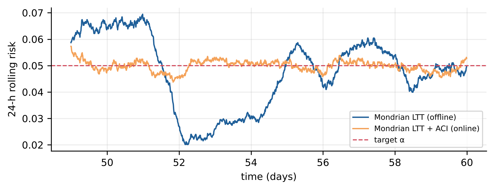
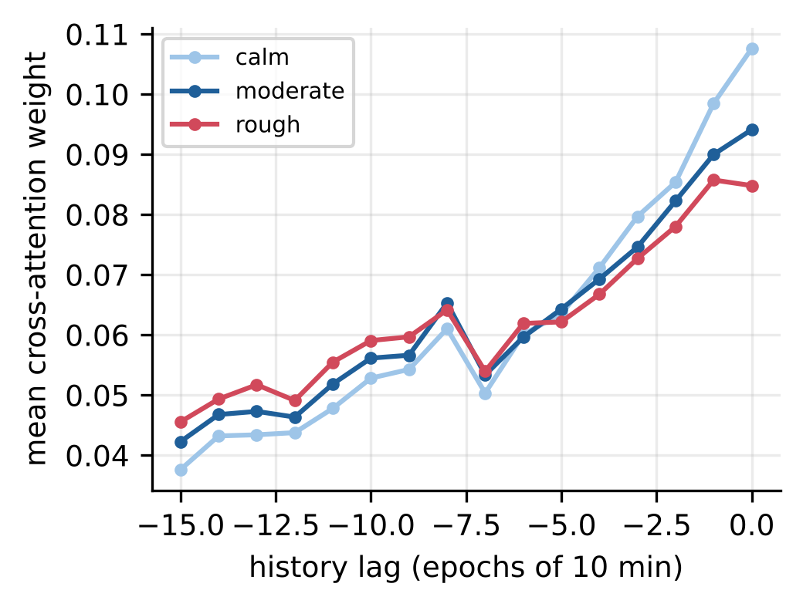
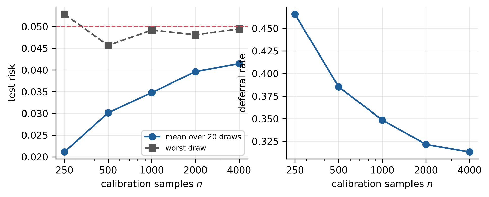

# 6 Quantitative results

All results are means ± standard deviations over three seeds, computed on the held-out test days (48–60) or on the out-of-distribution deployments. Raw per-seed outputs are released with the code.

## 6.1 Test-bed behaviour

Figure 3 shows ten days of one buoy at 20 km. Storm episodes raise $H_s$ above 2.5 m; the beacon SNR then drops by 5–10 dB and fluctuates faster, and the true success probability of SF7 collapses while SF12 degrades more slowly. Satellite opportunities appear as short bursts whose success probability varies with elevation. These traces confirm problem statements P1 and P2: the cheapest adequate action changes within hours and is tied to the sea state.

{width=95%}

## 6.2 Prediction quality

Table 4 compares the predictors. All models reach similar discrimination in distribution (AUROC 0.883–0.886), which is expected because much of the remaining uncertainty is aleatoric (wave phase and fading during the frame). WARDEN-Net has the lowest Brier score in distribution and under OOD-A, and its calibration error under the site shift (OOD-B, ECE 0.023) is lower than that of the Transformer baseline (0.032), gradient boosting (0.028) and the MLP (0.036), and close to the GRU (0.021). The differences in Brier score are small, below one per cent in relative terms, and we do not claim that the attention architecture is a large accuracy improvement on its own. Its value lies in delivering ordered, well-calibrated scores to the selection layer, as shown next. Figure 4 confirms that the calibrated WARDEN-Net probabilities lie close to the diagonal.

\needspace{16\baselineskip}

**Table 4** Prediction quality, mean of three seeds (ID: in distribution; A: OOD-A storms; B: OOD-B site shift; ECE with 15 bins). Standard deviations across seeds are at most 0.021 for AUROC, 0.010 for Brier and 0.009 for ECE; per-seed values are released with the code.

| Predictor | AUROC ID | Brier ID | ECE ID | Brier A | ECE A | Brier B | ECE B |
|------------------------|---------|---------|---------|---------|---------|---------|---------|
| Logistic regression | 0.884 | 0.0854 | 0.0062 | 0.0963 | 0.0174 | 0.0983 | 0.0270 |
| Gradient boosting | 0.884 | 0.0845 | **0.0027** | 0.0932 | **0.0057** | 0.0976 | 0.0284 |
| MLP | 0.883 | 0.0855 | 0.0058 | 0.0944 | 0.0098 | 0.0995 | 0.0358 |
| GRU | 0.885 | 0.0844 | 0.0042 | 0.0939 | 0.0086 | 0.0970 | **0.0214** |
| Transformer | 0.885 | 0.0847 | 0.0041 | 0.0942 | 0.0100 | 0.0985 | 0.0321 |
| **WARDEN-Net** | **0.886** | **0.0839** | 0.0042 | **0.0930** | 0.0092 | **0.0968** | 0.0229 |

{width=50%}

## 6.3 Risk-controlled link selection

This subsection evaluates the base engine of Sections 4.1–4.3; the two extensions are evaluated in Section 6.4.

Table 5 reports the decision metrics at $\alpha=0.05$. The rule-based policies never defer and therefore deliver readings with zero buffering delay, but they fail often: the ADR-style rule with a 10 dB margin fails 15.8 % of its attempts overall and 25.1 % in rough water, and changing the margin to 5 or 15 dB only moves the energy, not the risk. Naive thresholds on the WARDEN-Net scores show the two classic failure modes of uncertainty-unaware decisions: a threshold of 0.5 fails 16.7 % of the time, whereas the nominal threshold $1-\alpha$ is so conservative that more than half of the epochs are deferred and the delivery ratio drops to 0.58.

The certified policies behave as designed. Mondrian LTT keeps the realised risk at or below the target in every stratum, within the δ allowance (largest stratum mean 0.051 ± 0.003), while global LTT overshoots in rough water (0.053 ± 0.007) because its single threshold is dominated by the calmer majority of the calibration data. Adding the online update brings the risk to 0.050 in all three strata and every seed. At this operating point WARDEN delivers 80.8 % of all readings with a mean latency of 13 min and spends 32.6 ± 2.2 mJ per delivered reading, about five times less than the ADR rule (162.5 ± 9.8 mJ). It is even lower than the 39.2 mJ of the oracle, which delivers almost every reading and therefore also pays for the expensive frames needed in hard conditions; the oracle still defers 11 % of epochs to wait for a better link. The price is a delivery ratio 3.4 points below the ADR rule, because readings that cannot be sent reliably within 3 h are dropped.

\needspace{16\baselineskip}

**Table 5** Link-selection performance in distribution (α = 0.05, δ = 0.1; mean of three seeds). "Net" is the WARDEN-Net ensemble; WARDEN (full) adds the online update. Seed-to-seed standard deviations: overall risk ≤ 0.024 (0.000 for WARDEN), RDR ≤ 0.037 (0.003 for WARDEN), energy ≤ 14.2 mJ (2.2 mJ for WARDEN).

| Policy | Risk | Calm | Mod. | Rough | Defer | RDR | Lat. (min) | E (mJ) |
|------------------------|---------|---------|---------|---------|---------|---------|---------|---------|
| ADR, 5 dB | 0.175 | 0.090 | 0.155 | 0.282 | 0 | 0.825 | 0 | 126.9 |
| ADR, 10 dB | 0.158 | 0.088 | 0.138 | 0.251 | 0 | **0.842** | 0 | 162.5 |
| ADR, 15 dB | 0.159 | 0.099 | 0.139 | 0.243 | 0 | 0.841 | 0 | 216.0 |
| Always SF12 | 0.172 | 0.114 | 0.154 | 0.255 | 0 | 0.828 | 0 | 239.1 |
| Satellite first | 0.202 | 0.152 | 0.185 | 0.271 | 0 | 0.798 | 0 | 396.8 |
| Net + thr. 0.5 | 0.167 | 0.118 | 0.154 | 0.225 | 0.103 | 0.779 | 3.8 | 54.3 |
| Net + thr. 1−α | 0.012 | 0.012 | 0.015 | 0.009 | 0.523 | 0.583 | 15.3 | 20.8 |
| Net + global LTT | 0.046 | 0.036 | 0.051 | 0.053 | 0.297 | 0.804 | 13.8 | 31.5 |
| Net + Mondrian LTT | 0.044 | 0.035 | 0.051 | 0.048 | 0.302 | 0.798 | 13.5 | 31.4 |
| **WARDEN (full)** | **0.050** | 0.050 | 0.050 | 0.050 | 0.293 | 0.808 | 13.3 | **32.6** |
| Oracle (bound) | 0 | 0 | 0 | 0 | 0.111 | 0.998 | 3.3 | 39.2 |

Figure 5 shows the full trade-off as α varies from 0.01 to 0.20. Across the whole range the certified policies use 3–8 times less energy per delivered reading than the ADR family. The delivery ratio peaks near α = 0.10, where WARDEN delivers 82.6 ± 0.3 % of readings at 41.3 ± 3.7 mJ, i.e. 1.6 points below the 10 dB ADR rule for a quarter of its energy, with a certified failure rate of 10 % instead of an uncontrolled 15.8 %. Beyond α = 0.10 the delivery ratio falls again, because each additional failed unconfirmed frame destroys every buffered reading it carries. When α is set to the risk that the ADR rule incurs on the calibration days (0.166 ± 0.040), WARDEN matches that risk with 3.3 times less energy (48.6 versus 162.5 mJ) but a delivery ratio of 0.791 versus 0.842. The predictor matters only modestly at the policy level: at α = 0.05, WARDEN-Net gives the lowest energy among all predictors (32.6 mJ versus 33.8–38.8 mJ), whereas gradient boosting gives a 2.9-point higher delivery ratio at 17 % more energy. Because the certification layer is model agnostic, a deployment can choose either operating point without losing the guarantee.

{width=100%}

## 6.4 Physics-informed prior and urgency-aware certification (WARDEN-PI-U)

Table 6 and Fig. 6 compare the base engine with its two extensions under the online certificate at α = 0.05. Every certified policy keeps the realised attempt-failure risk at 0.049–0.050 in all three scenarios, whereas the ADR rule fails 9.7–19.5 % of its attempts. With the full training set, the physics-residual head does not improve probabilistic accuracy measurably (Brier 0.0842 versus 0.0839), because 36 days of data already let the network learn most of the wave physics. It does, however, improve the decisions: WARDEN-PI raises the reading delivery ratio from 0.808 to 0.834 in distribution, from 0.788 to 0.813 under storms and from 0.866 to 0.873 under the site shift, for 2–6 mJ more energy per reading.

The urgency-aware cells give the largest gain. With $\alpha_U=\alpha=0.05$, so that no additional risk is accepted for urgent traffic, WARDEN-PI-U delivers 86.2 ± 0.7 % of all readings in distribution, 84.5 ± 1.4 % under severe storms and 90.0 ± 1.1 % under the site shift. This exceeds the delivery ratio of the 10 dB ADR rule in distribution (84.2 %) and under storms (80.5 %) and matches it after the site shift (90.3 %), while using 4.2–4.6 times less energy per reading and certifying a failure rate three to four times lower. Ordinary traffic fails at exactly 5.0 %; urgent epochs, about 6 % of all epochs, fail at only 3.3 %, because their own working level adapts to the conditions in which buffers approach expiry instead of inheriting the threshold tuned for fresh data. The gain therefore comes from allocating the same risk budget more intelligently, not from relaxing it. The strongest learned baseline, gradient boosting, reaches 0.837 in distribution at 38.2 mJ; giving it the physics prior as features does not help (0.834), which indicates that the benefit of the prior is tied to the residual design of (30) rather than to the extra inputs.

\needspace{16\baselineskip}

**Table 6** Certified link selection with the WARDEN extensions (α = 0.05, α_U = 0.05, online certificate; mean of three seeds, delivery-ratio standard deviation in brackets)

| Scenario | Policy | Risk | Ordinary | Urgent | RDR | Lat. (min) | E (mJ) |
|----------|------------------------|---------|---------|---------|---------------|---------|---------|
| ID | ADR, 10 dB | 0.158 | – | – | 0.842 (0.011) | 0 | 162.5 |
| ID | Gradient boosting | 0.050 | – | – | 0.837 (0.005) | 12.4 | 38.2 |
| ID | Boosting + prior | 0.050 | – | – | 0.834 (0.005) | 12.3 | 39.2 |
| ID | Physics prior only | 0.050 | – | – | 0.827 (0.008) | 16.3 | 37.8 |
| ID | WARDEN | 0.050 | – | – | 0.808 (0.003) | 13.3 | 32.6 |
| ID | WARDEN-PI | 0.050 | – | – | 0.834 (0.009) | 16.4 | 35.5 |
| ID | **WARDEN-PI-U** | **0.049** | 0.050 | 0.033 | **0.862** (0.007) | 17.9 | 35.3 |
| OOD-A | ADR, 10 dB | 0.195 | – | – | 0.805 (0.021) | 0 | 185.9 |
| OOD-A | Gradient boosting | 0.050 | – | – | 0.812 (0.030) | 14.9 | 43.6 |
| OOD-A | WARDEN | 0.050 | – | – | 0.788 (0.028) | 16.8 | 35.6 |
| OOD-A | WARDEN-PI | 0.050 | – | – | 0.813 (0.028) | 18.7 | 41.1 |
| OOD-A | **WARDEN-PI-U** | **0.049** | 0.050 | 0.033 | **0.845** (0.014) | 20.0 | 40.9 |
| OOD-B | ADR, 10 dB | 0.097 | – | – | 0.903 (0.003) | 0 | 111.2 |
| OOD-B | Gradient boosting | 0.050 | – | – | 0.875 (0.013) | 6.3 | 28.5 |
| OOD-B | WARDEN | 0.050 | – | – | 0.866 (0.008) | 7.6 | 25.5 |
| OOD-B | WARDEN-PI | 0.050 | – | – | 0.873 (0.015) | 9.6 | 26.6 |
| OOD-B | **WARDEN-PI-U** | **0.049** | 0.050 | 0.032 | **0.900** (0.011) | 11.0 | 26.5 |

{width=100%}

## 6.5 Choosing the urgency budget

Table 7 varies the urgent-traffic target. Raising $\alpha_U$ above $\alpha$ is counter-productive: at $\alpha_U=0.30$ the urgent cell indeed fails 31 % of the time, but each failed unconfirmed frame destroys the whole buffer it carries, so the delivery ratio drops from 0.862 to 0.825. The best operating point is $\alpha_U=\alpha$, which is also the simplest to explain to an operator: one reliability target for all traffic, applied separately to ordinary and urgent epochs. The overall risk obeys the mixture (33) in every case.

\needspace{16\baselineskip}

**Table 7** Effect of the urgent-traffic target α_U (in distribution, α = 0.05; mean of three seeds)

| α_U | Risk (all) | Ordinary | Urgent | Urgent share | RDR | E (mJ) |
|--------|---------|---------|---------|---------|---------|---------|
| 0.05 | 0.049 | 0.050 | 0.033 | 0.063 | **0.862** | 35.3 |
| 0.10 | 0.051 | 0.050 | 0.077 | 0.042 | 0.858 | 36.1 |
| 0.20 | 0.054 | 0.050 | 0.197 | 0.026 | 0.838 | 36.8 |
| 0.30 | 0.055 | 0.050 | 0.311 | 0.020 | 0.825 | 37.0 |

## 6.6 Data efficiency during commissioning

A new buoy has little labelled data. Figure 7 repeats the experiment with only 2, 4 or 8 days of training data (one further day for temperature fitting and two days for calibration). Here the physics prior pays off clearly. With two days of data, WARDEN-PI lowers the Brier score of WARDEN-Net from 0.0958 to 0.0908 (5 %) and raises the delivery ratio from 0.746 to 0.773, and WARDEN-PI-U reaches 0.848 ± 0.011, above the ADR rule (0.842) and above gradient boosting (0.807) and the physics prior alone (0.809), at 29 mJ instead of 162 mJ per reading. With four and eight days, WARDEN-PI-U delivers 0.866 and 0.860. The certified risk stays at 0.049–0.052 throughout, because the guarantee does not depend on how good the predictor is; only the efficiency does.

{width=100%}

# 7 Ablation, robustness and OOD analyses

## 7.1 Out-of-distribution deployments

Table 8 and Fig. 8 report the two shifted deployments with models and thresholds taken unchanged from the in-distribution calibration. Under severe storms (OOD-A) the ADR rule fails 19.5 % of its attempts overall and 26.6 % in rough water. The offline certificate remains valid but becomes conservative (risk 0.038), and the online update recovers the unused risk budget, raising the delivery ratio from 0.743 to 0.788 at the target risk of 0.050. The site and hardware shift (OOD-B) is harder because it changes the conditional relationship between features and outcomes. Here the offline certificate is violated for every predictor that does not defer heavily: 0.052 for WARDEN-Net, 0.059–0.067 for the other non-recurrent models, and 0.063 for WARDEN-Net without cross attention. The online update restores 0.050 in every stratum within about one day (Fig. 9), with a delivery ratio of 0.866 and 25.5 mJ per reading, 4.4 times less than the ADR rule.

\needspace{16\baselineskip}

**Table 8** Behaviour under distribution shift (α = 0.05, mean of three seeds; overall-risk standard deviation ≤ 0.021, 0.000 for WARDEN)

| Scenario | Policy | Risk | Rough | RDR | E (mJ) |
|----------|------------------------------|---------|---------|---------|---------|
| A storms | ADR, 10 dB | 0.195 | 0.266 | 0.805 | 185.9 |
| A storms | Net + Mondrian LTT | 0.038 | 0.037 | 0.743 | 32.9 |
| A storms | **WARDEN (full)** | **0.050** | 0.050 | 0.788 | 35.6 |
| B site | ADR, 10 dB | 0.097 | 0.165 | 0.903 | 111.2 |
| B site | Transformer + Mondrian LTT | 0.063 | 0.063 | 0.887 | 30.8 |
| B site | Boosting + Mondrian LTT | 0.059 | 0.051 | 0.887 | 30.9 |
| B site | Net + global LTT | 0.053 | 0.061 | 0.871 | 27.2 |
| B site | Net + Mondrian LTT | 0.052 | 0.055 | 0.869 | 26.7 |
| B site | **WARDEN (full)** | **0.050** | 0.050 | 0.866 | **25.5** |

{width=100%}

{width=95%}

## 7.2 Ablation of WARDEN components

Table 9 isolates each component under offline Mondrian LTT, where differences in score quality show up directly as deferral and delivery. Removing the IMU features or setting the uncertainty penalty to κ = 0 makes the policy much more conservative and less stable across seeds (deferral 0.39 ± 0.09 and 0.38 ± 0.11 instead of 0.30 ± 0.01; delivery 0.75 instead of 0.80). Inspection shows the mechanism: without sea-state information or ensemble spread, the empirical risk curve of the calm stratum is ragged, and fixed-sequence testing stops at a high threshold. Removing cross attention barely changes in-distribution behaviour but raises the risk under the site shift from 0.052 to 0.063, and removing the SF-monotone head increases energy per reading by 9 % (34.2 versus 31.4 mJ) and raises the OOD-B risk to 0.056. A single network instead of a three-member ensemble costs 5 % more energy.

\needspace{16\baselineskip}

**Table 9** Ablation with offline Mondrian LTT (α = 0.05; ID: in distribution; B: OOD-B site shift; mean of three seeds, deferral with standard deviation)

| Variant | Defer (ID) | RDR (ID) | E (ID, mJ) | Risk (B) | ECE (B) |
|------------------------|---------------|---------|---------|---------|---------|
| WARDEN-Net, full | 0.302 ± 0.006 | 0.798 | 31.4 | 0.052 | 0.0229 |
| without IMU features | 0.390 ± 0.088 | 0.748 | 28.5 | 0.055 | 0.0228 |
| without cross attention | 0.305 ± 0.004 | 0.807 | 32.8 | 0.063 | 0.0376 |
| without SF-monotone head | 0.292 ± 0.012 | 0.797 | 34.2 | 0.056 | 0.0267 |
| single network (M = 1) | 0.302 ± 0.004 | 0.799 | 33.0 | 0.054 | 0.0258 |
| no penalty (κ = 0) | 0.377 ± 0.105 | 0.752 | 30.4 | – | – |

Figure 10 visualises the cross-attention weights learned by WARDEN-Net. In calm water the query concentrates on the most recent beacons, which carry the slowly varying shadowing and ducting state; in rough water the weights flatten and older steps receive more mass, consistent with averaging out wave-induced fluctuations. This behaviour was not imposed and supports the design rationale of Section 4.2.

{width=50%}

## 7.3 Robustness and calibration-set size

With IMU noise raised from 8 % to 30 %, offline Mondrian LTT still meets the target (0.042 ± 0.004) and the online version holds 0.050 with a delivery ratio of 0.815. With beacon SNR noise raised from 1 dB to 3 dB, the offline certificate sits at the boundary (0.050 ± 0.007, moderate stratum 0.055), and the online update again restores 0.050 in all strata. The ADR rule is unaffected by IMU noise but keeps its 15.8 % risk.

Figure 11 shows the effect of the calibration-set size. With only 250 calibration epochs, which corresponds to less than two days of a single buoy, 3.3 % of the 60 random draws violated the target, below the permitted δ = 10 %, and the worst draw reached 0.053. From 500 epochs upwards no draw violated the target. Larger calibration sets reduce conservatism: the deferral rate falls from 0.47 at n = 250 to 0.31 at n = 4 000.

{width=95%}

## 7.4 Robustness to a misspecified physics prior

A physics prior is only as good as its model. Table 10 trains and calibrates WARDEN-PI with the deliberately biased prior of Section 5.2. In distribution the residual network absorbs most of the error: the delivery ratio is unchanged (0.837 versus 0.834) and energy rises by 12 %. Under the two shifts the wrong prior becomes visibly miscalibrated (ECE 0.19–0.21 instead of 0.014–0.022), the policy compensates by choosing more robust and more expensive actions, and energy per reading roughly doubles. The certificate, however, still holds: the realised risk is 0.045–0.050 in every scenario. A wrong physics model therefore costs energy but not reliability, which is the property a safety-critical ocean deployment needs.

\needspace{16\baselineskip}

**Table 10** WARDEN-PI with correct and misspecified physics prior (α = 0.05, online certificate; mean of three seeds)

| Scenario | Prior | Risk | RDR | E (mJ) | ECE |
|----------|--------------|---------|---------|---------|---------|
| ID | correct | 0.050 | 0.834 | 35.5 | 0.008 |
| ID | misspecified | 0.050 | 0.837 | 39.7 | 0.016 |
| OOD-A | correct | 0.050 | 0.813 | 41.1 | 0.014 |
| OOD-A | misspecified | 0.045 | 0.857 | 73.6 | 0.213 |
| OOD-B | correct | 0.050 | 0.873 | 26.6 | 0.022 |
| OOD-B | misspecified | 0.048 | 0.897 | 51.9 | 0.194 |

# 8 Discussion, utility and limitations

WARDEN turns link reliability into a design parameter. The operator sets one failure target α and obtains it, per sea state, on every buoy; WARDEN-PI-U then delivers at least as many readings as an ADR-style rule in calm and stormy seas while spending four to five times less energy, which for a battery-limited buoy translates almost directly into service lifetime. The physics prior makes the scheme usable from the first days of a deployment, and the urgency cells remove the usual penalty of cautious policies, namely data that expire in the buffer. No change to LoRaWAN or LR-FHSS radios is needed: only a beacon with a receipt bitmap, a tide table and a small on-board model.

The limitations are equally concrete. All results come from a synthetic, physics-guided test bed, and the physics prior uses the same family of propagation models as the simulator; Table 10 bounds the damage of a wrong model, but sea trials are required before claims about real deployments. Training labels for all actions require probe frames in practice. Ordinary deliveries are delayed by about 15 min on average, and the online guarantee is a long-run average that does not bound short bursts of failures.

# 9 Conclusion

This paper presented WARDEN, a wave aware decision engine that lets an ocean monitoring buoy choose between LoRa spreading factors, a direct-to-satellite LR-FHSS frame and buffering with a certified bound on attempt failures. WARDEN combines four elements that had not been brought together for maritime links: a closed-form, wave-integrated physics prior driven by the buoy's own IMU; an attention network with sea-state-conditioned cross attention, an SF-monotone head and a physics-residual output; Mondrian Learn-then-Test calibration per sea state; and adaptive conformal updates organised in urgency-aware cells. In a 60-day, 20-buoy test bed with storm and site shifts, the full system held the failure rate at the 5 % target in every sea state and scenario, delivered 84.5–90.0 % of all readings, matching or exceeding an ADR-style rule that failed 10–20 % of its attempts, and used 4.2–4.6 times less energy per reading. The certificate held even with a deliberately wrong physics model, and two days of commissioning data sufficed to outperform the rule-based baseline. Future work will validate WARDEN in sea trials, replace full-label training with bandit feedback, bound short-term failure bursts, and extend the action set to multi-gateway and NB-IoT non-terrestrial links.

# Declarations

**Funding** This research received no specific grant from any funding agency in the public, commercial or not-for-profit sectors.

**Competing interests** The authors declare no competing interests.

**Data availability** All data are generated by the released simulator; the scripts reproduce every table and figure.

**Code availability** Source code is available at https://github.com/iitrky/warden.

**Author contributions** To be completed according to the CRediT taxonomy.

# References

1. Xia T, Wang MM, Zhang J, Wang L (2020) Maritime Internet of Things: Challenges and solutions. IEEE Wirel Commun 27(2):188–196. <https://doi.org/10.1109/MWC.001.1900322>
2. Alqurashi FS, Trichili A, Saeed N, Ooi BS, Alouini M-S (2023) Maritime communications: A survey on enabling technologies, opportunities, and challenges. IEEE Internet Things J 10(4):3525–3547. <https://doi.org/10.1109/JIOT.2022.3219674>
3. Wei T, Feng W, Chen Y, Wang C-X, Ge N, Lu J (2021) Hybrid satellite-terrestrial communication networks for the maritime Internet of Things: Key technologies, opportunities, and challenges. IEEE Internet Things J 8(11):8910–8934. <https://doi.org/10.1109/JIOT.2021.3056091>
4. Jahanbakht M, Xiang W, Hanzo L, Rahimi Azghadi M (2021) Internet of underwater things and big marine data analytics: A comprehensive survey. IEEE Commun Surv Tutor 23(2):904–956. <https://doi.org/10.1109/COMST.2021.3053118>
5. Parri L, Parrino S, Peruzzi G, Pozzebon A (2021) Offshore LoRaWAN networking: Transmission performances analysis under different environmental conditions. IEEE Trans Instrum Meas 70:1–10. <https://doi.org/10.1109/TIM.2020.3031193>
6. Centenaro M, Costa CE, Granelli F, Sacchi C, Vangelista L (2021) A survey on technologies, standards and open challenges in satellite IoT. IEEE Commun Surv Tutor 23(3):1693–1720. <https://doi.org/10.1109/COMST.2021.3078433>
7. Kodheli O, Lagunas E, Maturo N, Sharma SK, Shankar B, Montoya JFM, Duncan JCM, Spano D, Chatzinotas S, Kisseleff S, Querol J, Lei L, Vu TX, Goussetis G (2021) Satellite communications in the new space era: A survey and future challenges. IEEE Commun Surv Tutor 23(1):70–109. <https://doi.org/10.1109/COMST.2020.3028247>
8. Huo Y, Dong X, Beatty S (2020) Cellular communications in ocean waves for maritime Internet of Things. IEEE Internet Things J 7(10):9965–9979. <https://doi.org/10.1109/JIOT.2020.2988634>
9. He Y, Wang C-X, Chang H, Huang J, Sun J, Zhang W, Aggoune E-HM (2022) A novel 3D non-stationary maritime wireless channel model. IEEE Trans Commun 70(3):2102. <https://doi.org/10.1109/TCOMM.2021.3134275>
10. Liu Y, Wang C-X, Chang H, He Y, Bian J (2021) A novel non-stationary 6G UAV channel model for maritime communications. IEEE J Sel Areas Commun 39(10):2992–3005. <https://doi.org/10.1109/JSAC.2021.3088664>
11. Zhang H, Zhou T, Xu T, et al (2022) Statistical modeling of evaporation duct channel for maritime broadband communications. IEEE Trans Veh Technol 71(10):10228. <https://doi.org/10.1109/TVT.2022.3187753>
12. Robinson L, Newe T, Burke J, Toal D (2022) A simulated and experimental analysis of evaporation duct effects on microwave communications in the Irish Sea. IEEE Trans Antennas Propag 70(6). <https://doi.org/10.1109/TAP.2022.3145460>
13. Fang X, Feng W, Wang Y, Chen Y, Ge N, Ding Z, Zhu H (2023) NOMA-based hybrid satellite-UAV-terrestrial networks for 6G maritime coverage. IEEE Trans Wirel Commun 22(1):138–152. <https://doi.org/10.1109/TWC.2022.3191719>
14. Li X, Feng W, Wang J, Chen Y, Ge N, Wang C-X (2020) Enabling 5G on the ocean: A hybrid satellite-UAV-terrestrial network solution. IEEE Wirel Commun 27(6):116–121. <https://doi.org/10.1109/MWC.001.2000076>
15. Boquet G, Tuset-Peiró P, Adelantado F, Watteyne T, Vilajosana X (2021) LR-FHSS: Overview and performance analysis. IEEE Commun Mag 59(3):30–36. <https://doi.org/10.1109/MCOM.001.2000627>
16. Ullah MA, Mikhaylov K, Alves H (2022) Analysis and simulation of LoRaWAN LR-FHSS for direct-to-satellite scenario. IEEE Wirel Commun Lett 11(3):548–552. <https://doi.org/10.1109/LWC.2021.3135984>
17. Ullah MA, Pasolini G, Mikhaylov K, Alves H (2023) Understanding the limits of LoRa direct-to-satellite: The Doppler perspectives. IEEE Open J Commun Soc. <https://doi.org/10.1109/OJCOMS.2023.3337004>
18. Alvarez G, Fraire JA, Hassan KA, Céspedes S, Pesch D (2022) Uplink transmission policies for LoRa-based direct-to-satellite IoT. IEEE Access 10:72687–72701. <https://doi.org/10.1109/ACCESS.2022.3189647>
19. Røste T, Yang K, Wen C (2023) Satellite to buoy IoT communications in the Arctic Ocean. Front Mar Sci 10:1153798. <https://doi.org/10.3389/fmars.2023.1153798>
20. Zhou T, Liu X, Xiang Z, Zhang H, Ai B, Liu L, Jing X (2024) Transformer network based channel prediction for CSI feedback enhancement in AI-native air interface. IEEE Trans Wirel Commun. <https://doi.org/10.1109/TWC.2024.3379123>
21. Rizzello V, Böck B, Joham M, Utschick W (2024) Reverse ordering techniques for attention-based channel prediction. IEEE Open J Signal Process. <https://doi.org/10.1109/OJSP.2023.3344024>
22. Lim B, Arık SÖ, Loeff N, Pfister T (2021) Temporal fusion transformers for interpretable multi-horizon time series forecasting. Int J Forecast 37(4):1748–1764. <https://doi.org/10.1016/j.ijforecast.2021.03.012>
23. Strzoda A, Grochla K, Głomb P, Madej A (2023) Link failure prediction in LoRa networks. In: Proc Int Wirel Commun Mob Comput Conf (IWCMC). IEEE. <https://doi.org/10.1109/IWCMC58020.2023.10183185>
24. Shilpa B, Gupta HP, Jha RK, Hashmi SS (2024) LoRa interference issues and solution approaches in dense IoT networks: A review. Telecommun Syst 87:517–539. <https://doi.org/10.1007/s11235-024-01192-9>
25. Lyimo M, Mgawe B, Leo J, Dida M, Michael K (2026) LSTM-based deep reinforcement learning for ISI mitigation in maritime LoRaWAN. Phys Commun 75:103063. <https://doi.org/10.1016/j.phycom.2026.103063>
26. Leonardi L, Iannizzotto G, Pirri M, Patti G, Pirri A, Lo Bello L (2025) A deep learning-based adaptive data rate algorithm for LoRaWAN networks. Internet Things 101786. <https://doi.org/10.1016/j.iot.2025.101786>
27. Nisar F, Amin M, Irshad MT, Hadi HJ, Ahmad N, Ladan M (2025) Machine learning-based spreading factor optimization in LoRaWAN networks. Front Comput Sci 7:1666262. <https://doi.org/10.3389/fcomp.2025.1666262>
28. Dargie W, Poellabauer C, Tasissa A (2025) Prediction of the power of low-power networks using inertial sensors. IEEE Trans Instrum Meas 74:5506410
29. Cohen KM, Park S, Simeone O, Shamai S (2023) Calibrating AI models for wireless communications via conformal prediction. IEEE Trans Mach Learn Commun Netw 1:296–312. <https://doi.org/10.1109/TMLCN.2023.3319282>
30. Angelopoulos AN, Bates S (2023) Conformal prediction: A gentle introduction. Found Trends Mach Learn 16(4):494–591. <https://doi.org/10.1561/2200000101>
31. Deng W, Shi B, Li M, Simeone O (2026) SCAN-BEST: Sub-6GHz-aided near-field beam selection with formal reliability guarantees. IEEE Trans Cogn Commun Netw. <https://doi.org/10.1109/TCCN.2026.3657091>
32. Bates S, Angelopoulos A, Lei L, Malik J, Jordan MI (2021) Distribution-free, risk-controlling prediction sets. J ACM 68(6):43. <https://doi.org/10.1145/3478535>
33. Angelopoulos AN, Bates S, Fisch A, Lei L, Schuster T (2024) Conformal risk control. In: Proc Int Conf Learn Represent (ICLR). <https://proceedings.iclr.cc/paper_files/paper/2024/hash/f3549ef9b5ff520a7e41ff3cc306ab2b-Abstract-Conference.html>
34. Angelopoulos AN, Bates S, Candès EJ, Jordan MI, Lei L (2025) Learn then test: Calibrating predictive algorithms to achieve risk control. Ann Appl Stat 19:1641–1662. <https://doi.org/10.1214/24-AOAS1998>
35. Gibbs I, Candès E (2021) Adaptive conformal inference under distribution shift. In: Adv Neural Inf Process Syst 34 (NeurIPS). <https://proceedings.neurips.cc/paper/2021/hash/0d441de75945e5acbc865406fc9a2559-Abstract.html>
36. Parri L, Parrino S, Peruzzi G, Pozzebon A (2019) Low power wide area networks (LPWAN) at sea: Performance analysis of offshore data transmission by means of LoRaWAN connectivity for marine monitoring applications. Sensors 19(14):3239. <https://doi.org/10.3390/s19143239>
37. Dalton GA, Louis ABV, Thilahar CR, Muthuvel P (2026) Internet of things-based wireless communication system for smart ocean monitoring systems. Sci Rep 16:34122. <https://doi.org/10.1038/s41598-026-60101-z>
38. M A, Savarimuthu N, Gurunathan V, Kesavan S (2026) Parrot dandelion optimizer-based routing and spiking neural network enabled intrusion detection in underwater IoT. Sci Rep 16:32848. <https://doi.org/10.1038/s41598-026-64120-8>
39. Abinaya G, Sundaravadivel P, Vasudevan S, Muthulakshmi K (2026) Deep reinforcement learning-optimized adaptive authenticated encryption and dynamic transmission control for secure LoRaWAN IoT communication. Discov Internet Things 6:170. <https://doi.org/10.1007/s43926-026-00515-3>
40. Anita Sofia Liz DR, Rubavathi CY (2025) Enhanced recurrent attention-deep Q learning with optimal node constrains and effective penalty based model for data transmission scheduling on wireless sensor networks. PeerJ Comput Sci 11:e2950. <https://doi.org/10.7717/peerj-cs.2950>
41. Toro-Betancur V, Premsankar G, Slabicki M, Di Francesco M (2021) Modeling communication reliability in LoRa networks with device-level accuracy. In: Proc IEEE Conf Comput Commun (INFOCOM). <https://doi.org/10.1109/INFOCOM42981.2021.9488783>
42. Ren Y, Gamage A, Liu L, Li M, Chen S, Dong Y, Cao Z (2024) SateRIoT: high-performance ground-space networking for rural IoT. In: Proc 30th Annu Int Conf Mobile Comput Netw (MobiCom). ACM, pp 755–769. <https://doi.org/10.1145/3636534.3690659>
